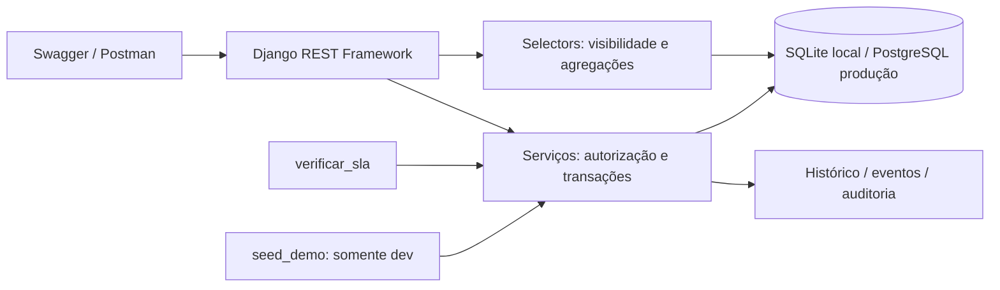

# Arquitetura

Views validam formato e chamam serviços; regras de estado, perfil e prazo ficam
nos serviços. Selectors restringem recursos antes da busca e fazem agregações
no banco. Operações compostas usam transaction.atomic e locks de linha no
PostgreSQL. SQLite não reproduz essas garantias de concorrência em produção.

Histórico de status, eventos e auditoria são somente inserção pelo ORM comum e
pelas APIs/Admin. SQL direto não é protegido por esse contrato da aplicação.
Eventos sem mudança de estado ficam separados do histórico de status.

JWT não carrega autorização de perfil estática: o usuário é consultado no banco
em cada requisição. Logout revoga refresh; desativação impede access/refresh.
As consultas de auditoria/métricas exigem Gestor e não fazem novas gravações.

Cada chamado preserva as quatro durações de SLA em snapshot. Reclassificação e
reabertura usam esse snapshot; ciclos e pausas preservam o histórico temporal.
Indicadores usam relógio atual, sem depender da frequência do job.

Referências: [ER](er.md), [estados](estados.md), [ADRs](adr/0001-stack-e-bancos.md),
[desenho completo](desenho-tecnico.md) e [demonstração](demo.md).
