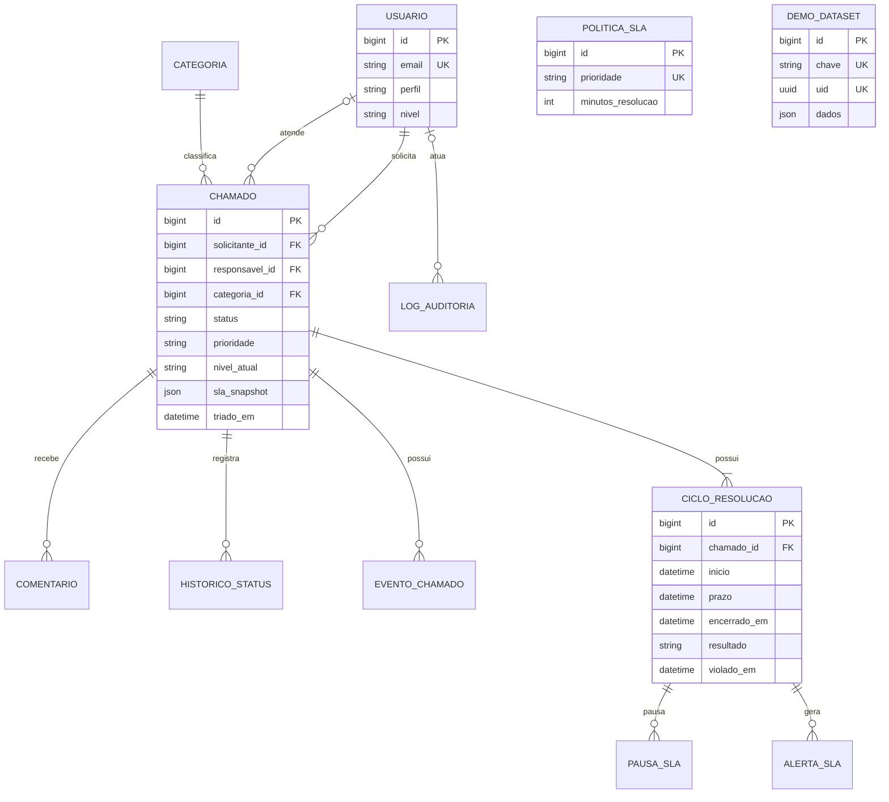

# Modelo de dados

A política não possui FK no chamado: suas durações são copiadas no snapshot para
preservar comportamento após alterações. Primeira resposta é obrigação por chamado;
resolução é por ciclo. Só pode existir um ciclo aberto por chamado e uma pausa
aberta por ciclo. Uma escalada por chamado e um alerta por ciclo/motivo.

Usuários/categorias usados são protegidos contra exclusão. Campos de autor de
histórico/evento/auditoria podem ser nulos para o sistema. O manifesto demo guarda
IDs/UUID e referência temporal, sem FKs ou senhas; sua integridade é conferida pelo seed.
