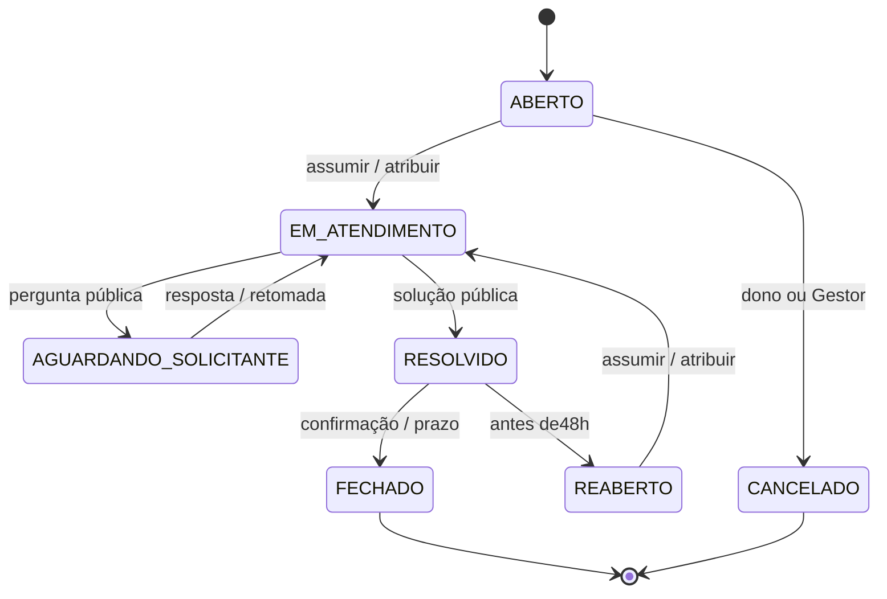

# Estados e níveis

Gestor pode atribuir e conduzir atendimento; a ação assumir é exclusiva de Analista
compatível com o nível. Assunção não conta como primeira resposta. Reabrir remove
responsável e cria novo ciclo, mantendo nível e primeira resposta.

N1/N2 é uma dimensão separada do status. Triagem é exclusiva de N1 não solicitante;
escalar exige triagem, mantém status e prazos e remove responsável para a fila N2.
Histórico de estado não recebe transições artificiais quando somente o nível muda.

Após48h da resolução sem interação do solicitante, a API bloqueia mutações mesmo
antes do job efetivar FECHADO. Interação reinicia apenas a inatividade para fechar;
a janela de reabertura continua fixa desde resolução. FECHADO/CANCELADO são terminais.
